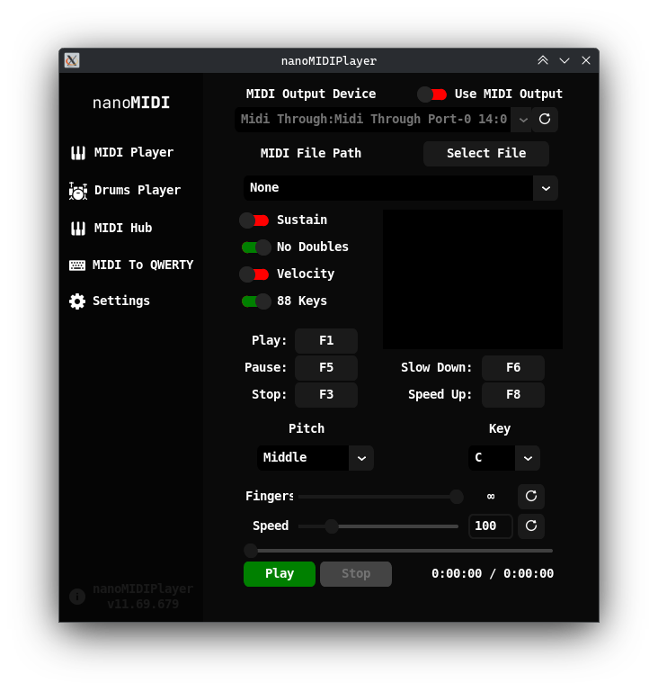
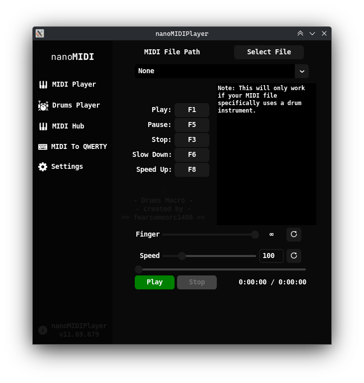
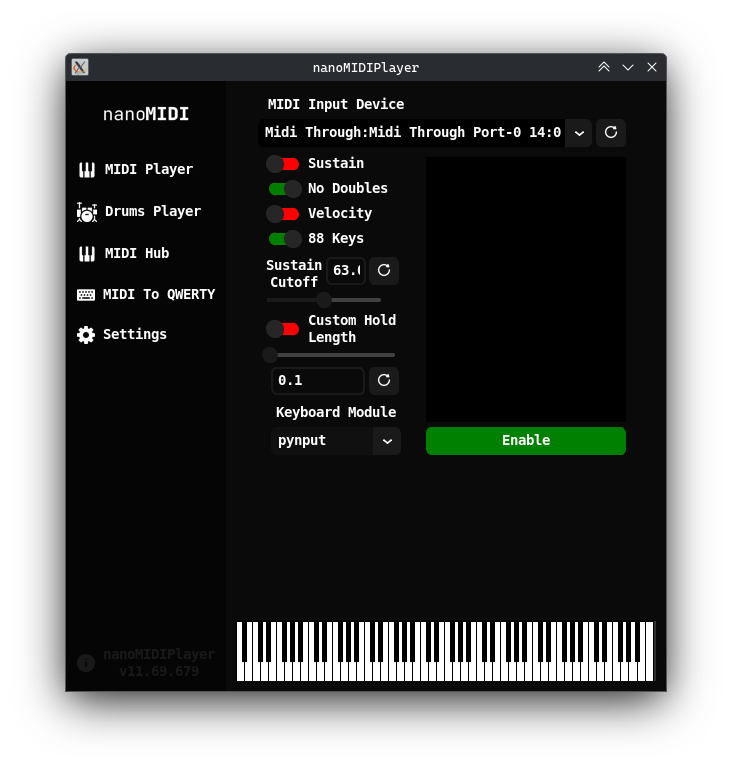
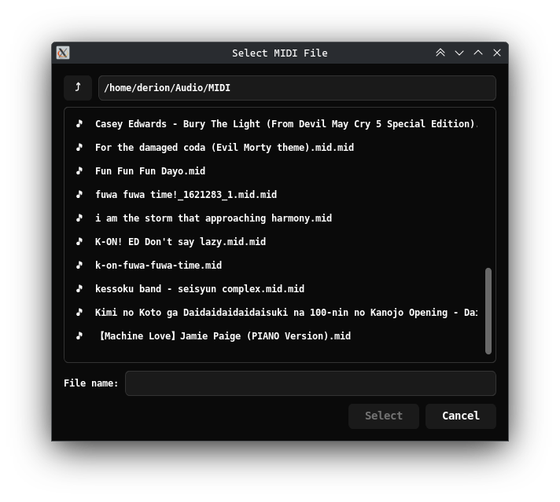
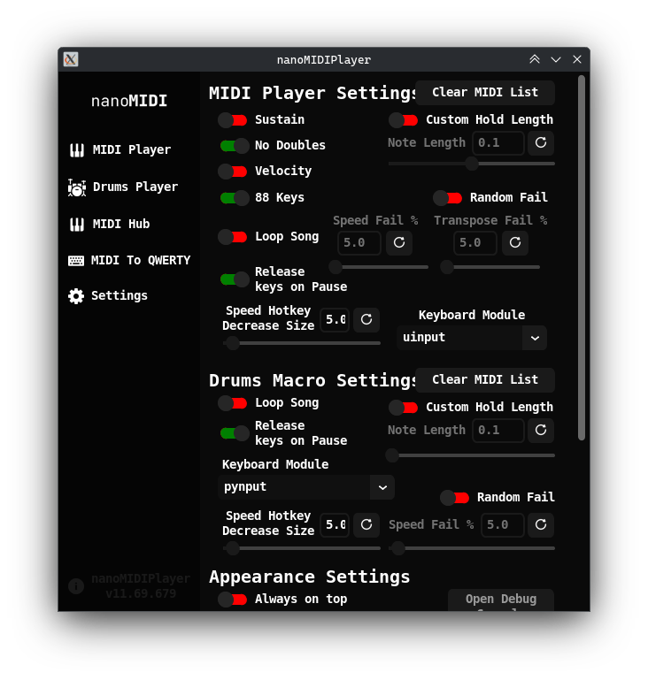

<p align="center">
  <a href="README.md">English</a> | <b>Русский</b>
</p>

# nanoMIDIPlayer-extended

<div align="center">


**Легковесный и высокопроизводительный MIDI-плеер и макро-движок с нативной поддержкой Wayland, глобальными горячими клавишами на уровне ядра, перемоткой по таймлайну в реальном времени и прямым выводом на MIDI-оборудование.**

[](https://github.com/derion-code/nanoMIDIPlayer-extended/releases/latest)
[](https://github.com/derion-code/nanoMIDIPlayer-extended/releases)
[](https://www.gnu.org/licenses/gpl-3.0)

[**Скачать релизы**](https://github.com/derion-code/nanoMIDIPlayer-extended/releases) • [**Настройка Linux Wayland**](#-настройка-linux-wayland-и-x11) • [**Использование CLI**](#-аргументы-командной-строки-cli) • [**Авторы и лицензия**](#-авторы-и-лицензия)

</div>

---

> [!NOTE]
> **nanoMIDIPlayer-extended** — это активно развивающийся улучшенный форк [NotHammer043/nanoMIDIPlayer](https://github.com/NotHammer043/nanoMIDIPlayer). Он решает давние проблемы совместимости с Linux/Wayland благодаря симуляции виртуальных устройств ядра через `uinput` и глобальным горячим клавишам `evdev`, устраняет взаимные блокировки (deadlocks) при воспроизведении, добавляет перемотку по таймлайну и встроенный современный файловый браузер с поддержкой тем оформления.

---

## 📖 Содержание

- [Обзор](#-обзор)
- [Скриншоты](#-скриншоты)
- [Ключевые улучшения в этом форке](#-ключевые-улучшения-в-этом-форке)
- [Возможности](#-возможности)
- [Настройка Linux (Wayland и X11)](#-настройка-linux-wayland-и-x11)
- [Установка и быстрый старт](#-установка-и-быстрый-старт)
- [Аргументы командной строки (CLI)](#-аргументы-командной-строки-cli)
- [Горячие клавиши и раскладки](#-горячие-клавиши-и-раскладки)
- [Сборка из исходного кода](#-сборка-из-исходного-кода)
- [Авторы и лицензия](#-авторы-и-лицензия)

---

## 🌟 Обзор

**nanoMIDIPlayer-extended** — это универсальный инструмент для воспроизведения MIDI и макросов. Он считывает стандартные файлы `.mid` и `.midi` и точно преобразует музыкальные ноты в симуляцию нажатий клавиш QWERTY для виртуальных пианино (в таких играх, как Roblox, Garry's Mod, Rust, веб-пианино и др.) либо отправляет «сырые» MIDI-данные напрямую на физические синтезаторы и виртуальные MIDI-loopback устройства.

В отличие от стандартных макро-плееров, которые не работают в современных Linux-окружениях, **nanoMIDIPlayer-extended** использует специализированную архитектуру для Linux, работающую «из коробки» в композиторах **Wayland** (GNOME, KDE Plasma, Hyprland, Sway) и X11 без ограничений по фокусу окна.

---

## 📸 Скриншоты

<!-- Placeholders for GitHub image drag-and-drop -->

| MIDI Player (таймлайн и управление) | Вкладка Drums Macro |
|:---:|:---:|
|  |  |

| Визуализатор MIDI в QWERTY в реальном времени | Современный файловый диалог |
|:---:|:---:|
|  |  |

<div align="center">

| Настройки |
|:---:|
|  |

</div>

---

## ✨ Ключевые улучшения в этом форке

### 🐧 Нативная симуляция нажатий клавиш через Wayland и `uinput`
В Wayland традиционные инструменты генерации синтетических нажатий клавиш для X11 (`pynput`, `xdotool`, `keyboard`) работают со сбоями или блокируются политиками безопасности композитора. В этом форке реализован выделенный бэкенд `uinput`, создающий виртуальное устройство ввода на уровне ядра (`/dev/uinput`). Нажатия клавиш распознаются на системном уровне во всех окружениях Wayland и полноэкранных играх.

### 🎯 Глобальные горячие клавиши через `evdev` на уровне ядра
Глобальные горячие клавиши часто перестают срабатывать, когда игра или другое приложение захватывает фокус. Этот форк добавляет слушатель событий `evdev`, считывающий «сырые» события устройств из `/dev/input/event*`:
- Горячие клавиши надежно срабатывают, даже когда плеер свернут или находится не в фокусе.
- Динамический хотплаг (hotplug) автоматически определяет подключение и отключение клавиатур.
- Петли обратной связи (feedback loops) от виртуальной клавиатуры безопасно отфильтровываются.
- Корректный откат (fallback) к `pynput` на платформах или в конфигурациях без `evdev`.

### ⏱️ Интерактивная перемотка по таймлайну (Scrubbing и Seeking)
Обе вкладки — **MIDI Player** и **Drums Macro** — оснащены интерактивным ползунком таймлайна:
- Перетаскивайте ползунок или нажимайте в любое место индикатора прогресса для мгновенного перехода в любую позицию.
- Использует бинарный поиск (`bisect`) для мгновенного перехода без задержек.
- Автоматически сбрасывает и отпускает зажатые клавиши при перемотке, предотвращая «залипание» нот.

### 🛡️ Предотвращение дедлоков и повышение потокобезопасности
- **Устранение Self-Join Deadlock**: Предотвращает зависание рабочих потоков воспроизведения при вызове реентрантных команд остановки горячими клавишами.
- **Мгновенная сигнализация состояния**: Флаги `stopEvent` и `closeThread` устанавливаются мгновенно, благодаря чему фоновые циклы завершаются без задержек.
- **Безопасная диспетчеризация интерфейса (UI Dispatch)**: Фоновые потоки передают изменения графического интерфейса и процедуры остановки в главный поток Tkinter с помощью `app.after(0, ...)`.
- **Гарантированное освобождение ресурсов**: Критические циклы воспроизведения защищены надежными блоками `try/finally`, что гарантирует отпускание клавиш и сброс таймеров даже в случае повреждения файла.

### 📂 Встроенный современный файловый менеджер
Системные диалоги выбора файлов заменены встроенным CustomTkinter проводником:
- Автоматически подстраивается под активную тему оформления приложения.
- Поиск в реальном времени с задержкой ввода (debounce).
- Запоминает последнюю использованную папку с MIDI между сессиями.
- Навигация по цепочке папок (breadcrumbs), быстрый доступ к дискам и навигация двойным кликом.

### 🎼 Расширенное управление высотой тона, транспонирование и ограничение пальцев
- **Сдвиг октав (Pitch Octave Shifting)**: Сдвиг воспроизведения по октавам (`Lowest` -2 окт., `Low` -1 окт., `Middle` по умолчанию, `High` +1 окт., `Highest` +2 окт.).
- **Полутоновое транспонирование (Semitone Transposition)**: Транспонирование воспроизведения по всем 12 музыкальным тональностям (от `C` до `B`).
- **Ограничитель полифонии (Polyphony Limiter)**: Ограничение количества одновременно нажатых клавиш от 1 до 10 пальцев либо режим без ограничений (`∞`).

---

## 🚀 Возможности

- **Два режима вывода**:
  - **Режим макросов (Macro Mode)**: Симулирует нажатия клавиш для виртуальных пианино (раскладки на 61 и 88 клавиш).
  - **MIDI-устройство вывода (MIDI Output Device)**: Отправляет «сырые» MIDI-сигналы напрямую на физические синтезаторы или виртуальные loopback-устройства (через `python-rtmidi`).
- **Живой ввод MIDI в QWERTY (Live MIDI Input to QWERTY)**:
  - Подключение USB MIDI-клавиатуры или контроллера для игры нот в реальном времени.
  - Интерактивный **графический визуализатор 88-клавишного пианино** отображает активные клавиши в прямом эфире.
- **Плеер барабанных макросов (Drums Macro Player)**: Специальный движок для партий ударных с настраиваемым маппингом элементов установки (Kick, Snare, Toms, Hi-Hats, Crashes, Ride, Cowbell).
- **Онлайн-каталог MIDI (Online MIDI Hub)**: Встроенный браузер на базе библиотеки [nanoMIDI.net](https://nanomidi.net) с поиском и сортировкой (Newest, Oldest, Downloads, Views).
- **Выразительность нажатий**:
  - **Симуляция силы нажатия (Velocity Simulation)**: Симулирует силу удара по клавише комбинациями с `ALT`.
  - **Педаль сустейна (Sustain Pedal)**: Эмулирует демпферную педаль нажатием `Spacebar` с настраиваемым порогом отсечки.
  - **Защита от дублирования (No Doubles)**: Алгоритм анти-гостинга для предотвращения случайных повторных ударов по клавишам.
- **Хуманизация (Random Fail)**: Имитация человеческих погрешностей с настраиваемыми ползунками дрейфа скорости и частоты ошибок транспонирования.
- **Темы и настройка интерфейса**:
  - Встроенные цветовые темы: Dark, Light, Discord, Oceanic, Forest, Halloween, Red Velvet.
  - Поддержка пользовательских JSON-тем, размещенных в `~/Documents/nanoMIDIPlayer/assets/customThemes/`.
  - Переключатель «Поверх остальных окон», вывод консоли в реальном времени и всплывающие подсказки.

---

## 🐧 Настройка Linux (Wayland и X11)

> [!IMPORTANT]
> Для использования симуляции `uinput` и глобальных горячих клавиш `evdev` в Linux учетная запись пользователя должна иметь доступ к `/dev/uinput` и `/dev/input/event*`. Без этих прав приложение переключается на `pynput` (который не может отправлять нажатия клавиш в окна Wayland и перехватывать глобальные горячие клавиши без фокуса).

Выполните следующие три шага для настройки системы:

### 1. Загрузка модуля ядра `uinput`
Убедитесь, что модуль ядра загружен:
```bash
sudo modprobe uinput
```
Для автоматической загрузки модуля при каждом старте системы:
```bash
echo "uinput" | sudo tee /etc/modules-load.d/uinput.conf
```

### 2. Установка правила udev
Создайте правило udev, предоставляющее группе `input` права записи в `/dev/uinput`:
```bash
echo 'KERNEL=="uinput", MODE="0660", GROUP="input", TAG+="uaccess"' | sudo tee /etc/udev/rules.d/99-uinput.rules
```
Перезагрузите и примените обновленные правила:
```bash
sudo udevadm control --reload-rules && sudo udevadm trigger
```

### 3. Добавление пользователя в группу `input`
Добавьте текущего пользователя в группу `input`:
```bash
sudo usermod -aG input $USER
```

> [!WARNING]
> Вам **НЕОБХОДИМО выйти из системы и войти снова** (или перезапустить сессию), чтобы новое членство в группе вступило в силу. Проверить свои текущие группы можно, выполнив команду `groups` в терминале.

---

## 📥 Установка и быстрый старт

### Вариант A: Готовые бинарные сборки (Рекомендуется)
Скачайте актуальную сборку для вашей операционной системы со [**страницы релизов**](https://github.com/derion-code/nanoMIDIPlayer-extended/releases):
- **Windows**: `.zip` (распаковать и запустить `.exe`)
- **macOS**: `.dmg` (смонтировать и перетащить в Applications)
- **Linux (Ubuntu/Debian/Mint)**: `.deb` (установить через `apt` или двойным кликом)
- **Linux (Arch)**: `.pkg.tar.zst` (установить через `pacman -U`)
- **Linux (Universal)**: `.AppImage` (`chmod +x` и запустить) или `.tar.gz`

### Вариант B: Запуск из исходного кода

#### Предварительные требования
- Python 3.10 или новее
- Git

#### 1. Клонирование репозитория
```bash
git clone https://github.com/derion-code/nanoMIDIPlayer-extended.git
cd nanoMIDIPlayer-extended
```

#### 2. Создание и активация виртуального окружения
```bash
# В Linux / macOS:
python3 -m venv venv
source venv/bin/activate

# В Windows (Command Prompt):
python -m venv venv
call venv\Scripts\activate.bat

# В Windows (PowerShell):
python -m venv venv
.\venv\Scripts\Activate.ps1
```

#### 3. Установка зависимостей
```bash
pip install --upgrade pip
pip install -r requirements.txt
```

#### 4. Запуск приложения
```bash
# В Linux (рекомендуется с uinput для Wayland):
python main.py --input-module uinput

# В Windows / macOS:
python main.py
```

---

## 💻 Аргументы командной строки (CLI)

`main.py` принимает флаги командной строки для настройки параметров запуска:

| Аргумент | Варианты | Описание |
| :--- | :--- | :--- |
| `--input-module` | `uinput`, `pynput`, `keyboard` | Устанавливает предпочитаемый драйвер симуляции нажатий клавиш для вкладок MIDI Player, Drums Macro и MIDI to QWERTY. |
| `--debug` | *(Нет)* | Открывает прикрепленное окно консоли отладки с подробным выводом логов во время работы. |
| `-h`, `--help` | *(Нет)* | Отображает справочную информацию и завершает работу. |

### Примеры использования CLI

* **Запуск с бэкендом `uinput` для Wayland:**
  ```bash
  python main.py --input-module uinput
  ```
* **Запуск с включенным подробным логированием:**
  ```bash
  python main.py --debug
  ```
* **Комбинирование параметров:**
  ```bash
  python main.py --input-module uinput --debug
  ```

---

## ⌨️ Горячие клавиши и раскладки

### Глобальные горячие клавиши по умолчанию

Все горячие клавиши можно настроить на вкладке **Settings**:

| Функция | Клавиша по умолчанию | Описание |
| :--- | :---: | :--- |
| **Play** | `F1` | Запускает или перезапускает воспроизведение загруженного MIDI-файла. |
| **Pause** | `F2` | Приостанавливает или возобновляет воспроизведение (отпускает зажатые клавиши, если настроено). |
| **Stop** | `F3` | Немедленно останавливает воспроизведение и сбрасывает таймлайн в начало. |
| **Speed Up** | `F4` | Увеличивает скорость воспроизведения на настроенный шаг. |
| **Slow Down** | `F5` | Уменьшает скорость воспроизведения на настроенный шаг. |

### Раскладка виртуального пианино
- **Режим 61 клавиши (61-Key Mode)**: Стандартные октавные ноты назначены на цифры `1`-`0`, строчные буквы `q`-`p`, `a`-`l`, `z`-`m`; черные клавиши нажимаются с модификатором `Shift` (или символами `!`, `@`, `$`, `%` и т. д.).
- **Режим 88 клавиш (88-Key Mode)**: Расширяет диапазон до самых низких и самых высоких октав пианино с использованием клавиш-модификаторов `Ctrl`.
- **Маппинг динамики (Velocity Mapping)**: Динамически передает уровни громкости нот через комбинации с клавишей `Alt` в поддерживаемых виртуальных пианино.
- **Сустейн (Sustain)**: Передает нажатие `Spacebar`, пока контроллер сустейна превышает заданный порог срабатывания (по умолчанию: `63`).

---

## 🛠️ Сборка из исходного кода

Сборка из исходного кода больше не требуется для конечных пользователей. Официальные бинарные файлы автоматически собираются и публикуются через GitHub Actions для всех платформ (Windows, macOS, Linux, Arch) при публикации каждого нового тега. Разработчики по-прежнему могут запускать приложение локально с помощью Python (см. вариант B выше).

---

## 📜 Авторы и лицензия

### Оригинальный проект (Upstream)
**nanoMIDIPlayer-extended** — это расширенный форк **[nanoMIDIPlayer](https://github.com/NotHammer043/nanoMIDIPlayer)**, изначально разработанного и поддерживаемого **[NotHammer043](https://github.com/NotHammer043)**.

- **Репозиторий оригинала**: [NotHammer043/nanoMIDIPlayer](https://github.com/NotHammer043/nanoMIDIPlayer)
- **Официальный сайт и каталог MIDI**: [nanoMIDI.net](https://nanomidi.net)
- **Поддержать автора оригинала**: Вы можете поддержать разработку апстрим-проекта через **BuyMeACoffee**:

<div align="center">

[](https://www.buymeacoffee.com/nanoMIDI)

</div>

Особая благодарность NotHammer043, [fearsomeorc1406](https://discord.com/users/1292364099581116416) (создателю Drums Macro) и сообществу nanoMIDI за основу, темы и поддержку.

### Лицензия
Этот проект лицензирован под **GNU General Public License v3.0 (GPLv3)**. Подробности см. в файле [LICENSE](file:///home/derion/projects/nanoMIDIPlayer-extended/LICENSE).
